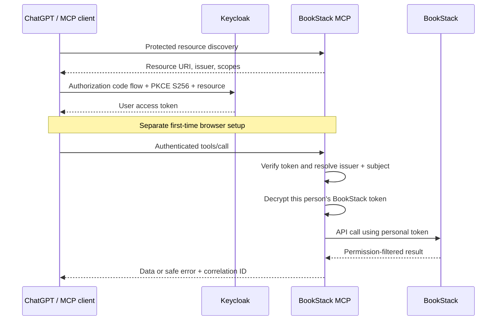

# BookStack MCP

A standalone, per-user [Model Context Protocol](https://modelcontextprotocol.io/) server for BookStack. Connect an MCP client directly over HTTPS, authenticate people with Keycloak, and use each person's encrypted BookStack API token. BookStack enforces its existing content permissions on every request.

**Status:** the reference pilot is deployed behind HTTPS, with a healthy non-root container and dedicated Keycloak web and ChatGPT clients. Personal web login and API-key storage have succeeded. The [plugin package](plugin/README.md) has been saved as a private workspace plugin, but its registered ChatGPT MCP app binding is still missing: uploading the archive alone did not expose the direct tools. The complete ChatGPT flow is **not working or verified yet**. See [verification results](docs/verification.md) and the [deployment checklist](docs/production-checklist.md).

## Features

| Tool                          | Purpose                                                         | Required OAuth scopes |
| ----------------------------- | --------------------------------------------------------------- | --------------------- |
| `bookstack_connection_status` | Check whether your personal token is stored; get the setup link | `bookstack:read`      |
| `bookstack_search`            | Search permitted content using BookStack search syntax          | `bookstack:read`      |
| `bookstack_browse`            | Paginate shelves, books, chapters, or pages                     | `bookstack:read`      |
| `bookstack_read`              | Read a page or a container and its navigation data              | `bookstack:read`      |
| `bookstack_create_page`       | Create Markdown or HTML documentation in a book or chapter      | Both scopes           |
| `bookstack_update_page`       | Update selected page fields, including content and tags         | Both scopes           |
| `bookstack_create_container`  | Create a book or a chapter                                      | Both scopes           |
| `bookstack_update_container`  | Change a book/chapter name or description                       | Both scopes           |

The second scope is `bookstack:write`. Write tools are annotated as destructive and non-idempotent; read tools have `readOnlyHint: true`. All tools have `openWorldHint: true` because they access an external service. The server does not expose deletion, permission management, user administration, attachments, arbitrary HTTP requests, or command execution.

Page updates replace the supplied content field rather than applying a text patch. Read the page before editing. BookStack's supported API does not provide an atomic compare-and-swap operation here, so concurrent edits can be overwritten. Ambiguous write failures are never retried automatically.

## Architecture and authentication



Keycloak is the **OAuth authorization server**. This service is the **OAuth protected resource server**, publishing RFC 9728 metadata at `/.well-known/oauth-protected-resource/mcp` and a root discovery alias. The canonical resource and JWT audience are exactly `<publicOrigin>/mcp`. The MCP service neither issues OAuth tokens nor implements client registration. ChatGPT obtains and refreshes its tokens directly from Keycloak. There is no LiteLLM dependency or shared administrator fallback.

For browser token management, the service is also an **OIDC relying party**, using a separate confidential web client. Its authorization-code flow includes PKCE, state, nonce, signed ID-token verification, and access-token verification. The access and ID tokens must resolve to the same issuer and subject. The resulting opaque browser session is server-side, encrypted, and limited to the earlier of access-token expiry or 15 minutes. No access or refresh token is retained in that session. Pending logins expire after five minutes and are lost on restart.

Every MCP request, including tool discovery and unsupported session operations, requires a signed Keycloak access token. Validation checks the signature against the configured issuer's JWKS, issuer, exact audience, expiry, issued-at, subject, not-before when present, `typ=Bearer`, and `bookstack:read`. Accepted signature algorithms are RS256, PS256, and ES256. Writes also require `bookstack:write`. OIDC ID tokens and refresh tokens are rejected as MCP credentials. A five-second clock tolerance applies.

Stored BookStack keys are bound to the exact validated `(issuer, subject)` pair. Email, names, tool arguments, and unsigned headers never select an account. Configure both Keycloak clients to yield the same stable subject; pairwise subjects require an explicit identity design and are not linked automatically.

**Ordinary OIDC login is not sufficient for ChatGPT MCP authorization.** Keycloak must also satisfy MCP client registration, discovery, resource binding, PKCE, scopes, and refresh requirements. Its current documentation labels resource indicators and CIMD experimental. Review the installed Keycloak version and the [concrete deployment checklist](docs/production-checklist.md) before changing a shared identity service. This repository does not assume these features are already enabled.

## Personal BookStack tokens

The Norwegian setup page at `/setup` supports initial connection, replacement, and deletion. It requires job-account login, same-origin form submission, a session-bound CSRF token, and confirmation that the submitted BookStack token is personal. Token ID and Token Secret are accepted only by this browser form, never as MCP arguments. Saved values are never displayed or returned to a model.

The form tests the token with `GET /api/system` before saving and checks the configured BookStack version. Failed validation preserves the existing stored key. The initial contract was checked against **BookStack v26.09.2**; an unauthenticated inspection of the target's login-page asset URLs reports that version. Authenticated version verification against that target still requires a personal API token. See [sources and limitations](docs/research.md).

**Token ownership cannot be verified through the documented API in this BookStack version.** There is no supported current-user endpoint; `/api/system` identifies the instance rather than the caller. Successful token validation does not prove that its owner matches the Keycloak user. The setup page states this limitation and asks the person to confirm ownership. Do not grant user-administration rights to work around it.

BookStack requires the person's **Access System API** role permission. The [Norwegian first-time guide](docs/first-login.nb.md) explains token creation and the distinction between:

- Disconnecting the ChatGPT plugin: ends that client connection.
- Deleting the stored key here: removes the MCP service's copy.
- Revoking/deleting the actual token in BookStack: invalidates that credential at its source.

Browser logout only ends the local browser session. It does not perform any of those three actions.

## Stack

Node.js 22.23 or later, TypeScript, the official MCP TypeScript SDK v2, Express, `openid-client`, `jose`, and SQLite through `better-sqlite3`. Server-rendered HTML avoids a frontend build or browser token storage. SQLite keeps a small single-instance service easy to back up; AES-256-GCM protects credentials and session data with separate, operator-managed keys. Exact JavaScript dependency versions and transitive versions are committed in `package.json` and `package-lock.json`.

This is a new implementation. Existing local MCP services were read only for deployment conventions; no existing service code or production configuration was modified.

## Local development

```sh
npm ci
npm run typecheck
npm test
npm run build
npm run smoke:runtime
```

Tests use isolated SQLite databases, generated signing keys, local OIDC/JWKS servers, and BookStack mocks. They make no production writes and do not require real credentials. The official MCP client is tested over real loopback HTTP; 2025-11-25 stateless requests are also tested. Production runs use SDK-supported protocol negotiation, including the current per-request protocol.

The runtime smoke check starts the compiled executable with a temporary local mock issuer, verifies startup and protected routes, and shuts it down. It requires `npm run build` first. CI also checks formatting and builds the container; it does not deploy services or call production BookStack.

To run against an actual development Keycloak:

1. Copy `config/example.json` to an operator-owned configuration file and replace the example issuer, public origin, and client ID. Use absolute local paths for the database and secret files.
2. Register the web client and API audience/scopes using the [checklist](docs/production-checklist.md).
3. Create a private secret directory and generate a keyring without printing its key:

   ```sh
   install -d -m 700 "$HOME/.config/bookstack-mcp"
   npx tsx scripts/create-keyring.ts "$HOME/.config/bookstack-mcp/keyring.json"
   ```

4. Put the web client's secret in a separate UTF-8 file with mode `0600` or `0400`, outside the repository. Configure `webClientSecretFile` and `keyringFile` accordingly. Symlinks and group/world-readable secret files are rejected.
5. Start the server as an unprivileged account:

   ```sh
   BOOKSTACK_MCP_CONFIG=/absolute/path/config.json npm start
   ```

`npm run dev` runs the TypeScript source with reload. Startup fails closed if configuration, key files, SQLite, or Keycloak discovery/S256 checks fail. The logs identify the failed startup stage without dumping credential-bearing exceptions.

`publicOrigin` determines callback URLs, exact Host validation, cookie security, and the MCP resource; it must match the URL clients use. Bind `host` to `127.0.0.1` for native local operation. For an explicitly local-only HTTP development setup, set `allowInsecureLocalhost: true` and use literal loopback or localhost URLs. This switch never permits public plain HTTP. There is no authentication-bypass development mode.

## Container and HTTPS deployment

```sh
docker build -t local/td-bookstack-mcp:0.1.0 .
BOOKSTACK_MCP_PUBLIC_HOST=your-reviewed-public-host.example.org docker compose config --quiet
BOOKSTACK_MCP_PUBLIC_HOST=your-reviewed-public-host.example.org docker compose up -d
```

The Dockerfile pins a Node base-image digest and runs as UID/GID `1000:1000`. Compose adds a read-only root filesystem, dropped capabilities, no-new-privileges, memory/PID limits, log rotation, and a port published only on host loopback. **For this bridge-network container, set configuration `host` to `0.0.0.0`**; the host still exposes only `127.0.0.1:8110`. Set `port` to 8110. Native host execution can keep `127.0.0.1`.

Before starting, provision `/etc/bookstack-mcp/config.json`, the separate secret files in that directory, and `/var/lib/bookstack-mcp`. The state directory must be owned by `1000:1000` and mode `0700`; the secret files must be readable by UID 1000 and mode `0400` or `0600`. Parent directories should prevent access by unrelated users. The configuration's paths must match the mounts in `compose.yaml`. Run only one application instance against this SQLite database; use local disk, not a network filesystem. A horizontal deployment would require shared sessions, rate limits, and a suitable shared database.

Publish a dedicated HTTPS origin through a reviewed reverse proxy. [nginx.example.conf](docs/nginx.example.conf) is a proposal, not an installed configuration. Preserve Host and Authorization; turn off buffering and caching. Do not log callback query strings, authorization headers, cookies, or POST bodies in the proxy/WAF. If using another proxy, review its default error/access logging too.

Configure `trustedProxies` with the exact proxy addresses/CIDRs only when forwarded client addresses are needed for rate limiting. Otherwise the default treats connections as coming from the direct peer. `allowedMcpOrigins` is an optional exact-origin allowlist for browser MCP clients. ChatGPT's server-to-server requests normally have no Origin; no wildcard CORS is configured.

ChatGPT must reach the public MCP HTTPS endpoint and its discovery documents, plus Keycloak's authorization/discovery/token endpoints. Technicians' browsers must reach Keycloak and the setup site's HTTPS pages. The MCP server must reach Keycloak discovery/JWKS/token endpoints and the fixed BookStack address. BookStack itself need only be reachable from this server. ChatGPT is not assumed to have access to a technician's LAN or VPN.

`GET /healthz` exposes only process liveness. It does not prove Keycloak availability, token validity, database restoration, or upstream permissions. Other public routes are generic instructions, CSS, discovery, and the necessary login endpoints. User status, keys, and all MCP operations remain protected.

## Backups, key rotation, and revocation

Keep encryption keys outside both the database and source tree. A keyring has `activeKeyId` and `keys`, with each AES key encoded as canonical base64 for 32 random bytes. New writes use the active key; older key IDs remain available for decryption. Credential encryption authenticates its issuer/subject binding, preventing ciphertext from being copied between users.

For a simple consistent backup, stop this single-instance service, copy the complete state directory (including any SQLite WAL/SHM files), and restart. Alternatively use SQLite's supported online backup API rather than copying a live database file alone. Back up configuration and necessary keyring versions separately with restricted, encrypted storage. The database and the matching keys are both required to restore credentials. Test a restore in an isolated environment before relying on it; repository tests cover file-backed restore, not your production backup system.

To rotate the encryption key:

1. Take and verify a backup; stop the service.
2. Add a newly generated 32-byte key to the private keyring and select its new ID. Retain all old entries.
3. Run `BOOKSTACK_MCP_CONFIG=/absolute/path/config.json npm run rotate-keys`, or `node dist/rotate.js` in the built runtime. All credential rows are re-encrypted transactionally, browser sessions are cleared, and the WAL is checkpointed.
4. Verify a restore and personal read access with the new keyring; restart the service. Retain old keys for as long as retained backups need them.

Database deletion is logical removal from the active service. `secure_delete` is enabled, but old backups, storage snapshots, and WAL history may retain encrypted records; it is not a forensic erasure guarantee. Revoking the actual API token in BookStack is the reliable way to invalidate all copies.

Keycloak JWTs are verified locally, without per-request introspection. Disabling a Keycloak user/session does not immediately invalidate an already-issued access token: it may remain usable until expiry plus five seconds. Configure short access-token lifetimes (for example five minutes), revoke refresh sessions as needed, and stop access to this service for an immediate incident response. Browser sessions last at most 15 minutes and never outlive their original access token. Removing a BookStack key immediately blocks subsequent tool calls needing that key, but cannot recall an upstream request already in flight.

## Troubleshooting

Every response has `X-Correlation-ID`; tool results and safe errors include the same ID. Search JSON application logs for that value. Logs include operation names, safe error codes, upstream status, timings, and pseudonymous actor identifiers; they omit JWTs, cookies, API secrets, request arguments, upstream response bodies, and document content. Treat logs as operational data with an appropriate retention policy.

| Code                                                | Meaning / next step                                                               |
| --------------------------------------------------- | --------------------------------------------------------------------------------- |
| `MCP_LOGIN_REQUIRED`, `MCP_LOGIN_FAILED`            | Missing, invalid, or expired login; sign in/reconnect                             |
| `MCP_SCOPE_REQUIRED`, `MCP_WRITE_SCOPE_REQUIRED`    | Check client scopes and consent; HTTP challenges name required scopes             |
| `BOOKSTACK_KEY_MISSING`                             | Open the setup URL and save your personal token                                   |
| `BOOKSTACK_KEY_REJECTED`                            | Replace the rejected, revoked, or expired BookStack token                         |
| `BOOKSTACK_PERMISSION_DENIED`                       | Check Access System API and content permissions in BookStack                      |
| `BOOKSTACK_NOT_FOUND`                               | Content is absent or hidden by BookStack permissions                              |
| `BOOKSTACK_VERSION_MISMATCH`                        | Review API compatibility after an upstream upgrade                                |
| `BOOKSTACK_VALIDATION`                              | Check fields and parent container                                                 |
| `BOOKSTACK_NETWORK`, `BOOKSTACK_UPSTREAM`           | Check network/TLS/upstream health; inspect write outcome before retrying          |
| `BOOKSTACK_RATE_LIMIT`                              | Wait; review call volume                                                          |
| `BOOKSTACK_BAD_RESPONSE`                            | Invalid/unexpected or oversized JSON; check upstream and reduce requested content |
| `CSRF_REJECTED`, `HOST_REJECTED`, `ORIGIN_REJECTED` | Reopen setup or check canonical URLs/proxy settings                               |
| `MCP_INTERNAL`                                      | Internal failure; provide correlation ID to the operator                          |

BookStack v26.09.2 also reports expired API tokens as HTTP 403. The service recognizes its exact English and Norwegian Bokmål expiry messages without returning or logging the raw error. Other translations/custom error pages can leave a 403 ambiguous; check the token's expiry as well as permissions. This limitation is covered in [research notes](docs/research.md).

For safe upstream checks:

```sh
BOOKSTACK_MCP_CONFIG=/absolute/path/config.json npm run check-upstream
# Optional authenticated GET-only checks; never put token values on the command line:
BOOKSTACK_MCP_CONFIG=/absolute/path/config.json npm run check-upstream -- --credential-file /protected/personal-token.json
```

The optional private file contains `tokenId` and `tokenSecret` and must have mode `0600` or `0400`. The script reads `/api/system` and at most one book listing without printing content. No authenticated upstream check has been performed for the initial delivery.

## Documentation and contribution

- [Norwegian first-login guide](docs/first-login.nb.md)
- [Production / Keycloak / ChatGPT checklist](docs/production-checklist.md)
- [Research, version evidence, and official references](docs/research.md)
- [Verification report](docs/verification.md)
- [Contributing](CONTRIBUTING.md), [security reporting](SECURITY.md), and [license](LICENSE)

Use mock data when contributing. Never commit a real API token, OAuth client secret, keyring, configuration containing secrets, database, or production document.
